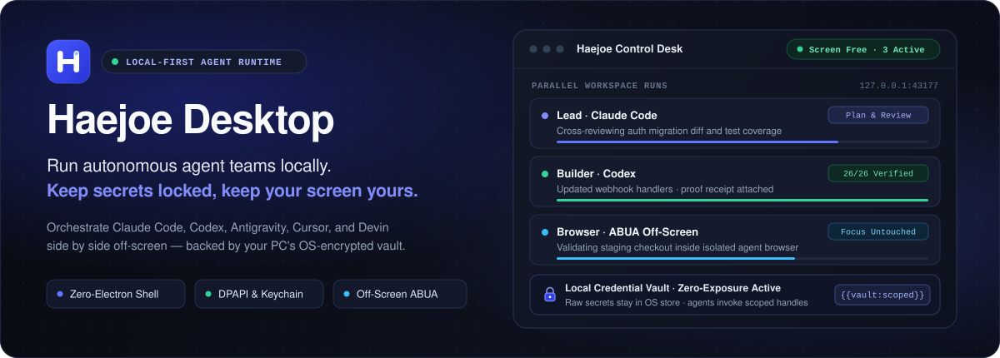
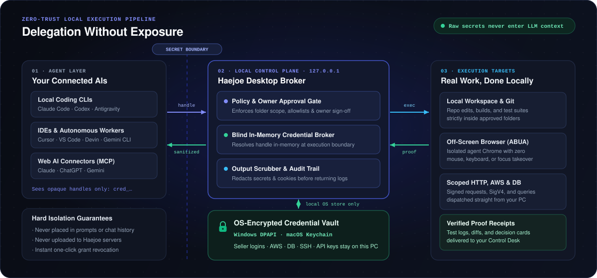
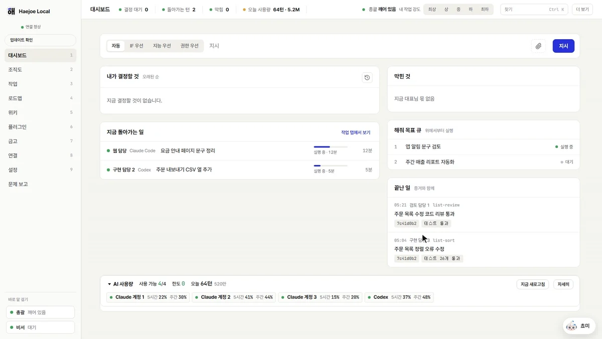
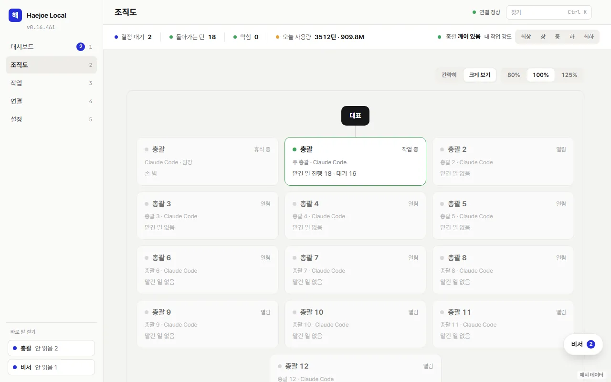
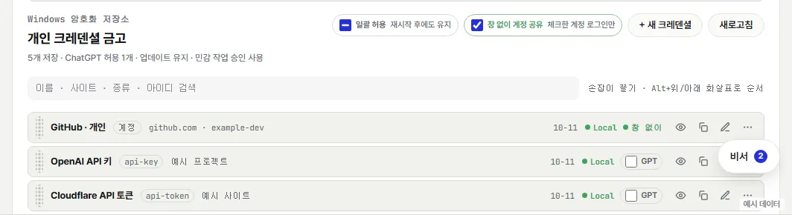

<div align="center">

<picture>
  <source media="(prefers-color-scheme: dark)" srcset="assets/hero-dark.svg" />
  <source media="(prefers-color-scheme: light)" srcset="assets/hero-light.svg" />
  
</picture>

<br />

<h3>내 PC에서 자율 에이전트 팀을 굴립니다. 비밀값은 금고에, 화면은 내 손에 둡니다.</h3>

<p>
  <a href="README.md">English</a> &nbsp;·&nbsp;
  <strong>한국어</strong> &nbsp;·&nbsp;
  <a href="https://haejoe.com/local">공식 페이지</a> &nbsp;·&nbsp;
  <a href="https://haejoe.com/local/setup">초기 설정 안내</a> &nbsp;·&nbsp;
  <a href="SECURITY.md">보안 정책</a> &nbsp;·&nbsp;
  <a href="CHANGELOG.md">변경 이력</a>
</p>

<p>
  <a href="https://github.com/thekeunpie-hash/haejoe-desktop/releases/latest">
    
  </a>
  <a href="https://haejoe.com/local">
    
  </a>
  <a href="#빠른-설치">
    
  </a>
  <a href="SECURITY.md">
    
  </a>
  <a href="https://chromewebstore.google.com/detail/haejoe-browser-remote/jgkchidplncmhdokaakfdljnlgmihhnn">
    
  </a>
</p>

<p>
  <sub>
    해줘 데스크탑은 비공개 소스 상용 데스크탑 제품입니다. 이 저장소에는 릴리스 안내, 구조 설명, 무결성 검증 방법과 이슈 트래커만 공개합니다. (<a href="docs/README.ko.md">docs/README.ko.md</a>)
  </sub>
</p>

</div>

---

## 빠른 설치

터미널에 한 줄을 붙여 넣으면 설치가 끝납니다. 두 설치 스크립트 모두 공식 매니페스트를 HTTPS로 읽어 파일 크기와 SHA-256 해시가 정확히 일치할 때만 실행하며, 조금이라도 다르면 즉시 중단합니다.

### Windows (PowerShell)

```powershell
irm https://haejoe.com/install.ps1 | iex
```

### macOS / Linux (Terminal)

```bash
curl -fsSL https://haejoe.com/install.sh | sh
```

<details>
<summary><strong>Claude Code · Codex · Antigravity로 자동 설치하기</strong></summary>

<br />

이미 AI 코딩 CLI를 쓰고 있다면 아래 지시문을 대화창에 그대로 붙여 넣으세요. 설치부터 MCP 커넥터, 훅, 작업 폴더 동기화까지 에이전트가 알아서 마무리합니다. 비밀번호나 카드 번호는 입력하지 않으며 로그인이 필요할 때만 창을 열어 둡니다.

**Windows**

```text
해줘 데스크탑을 이 PC에 설치하고 연결까지 끝내 줘.
1) 터미널에서 irm https://haejoe.com/install.ps1 | iex 를 실행해 설치한다.
2) 설치가 끝나면 https://haejoe.com/local/setup.txt 를 읽고 나열된 절차(`haejoe-local setup plan --json`, `haejoe-local setup apply`, `haejoe-local setup report`)대로 AI CLI 연결을 마친다.
비밀번호와 카드 번호는 입력하지 말고, 로그인이 필요하면 로그인 창만 열어 둔다.
```

**macOS / Linux**

```text
해줘 데스크탑을 이 PC에 설치하고 연결까지 끝내 줘.
1) 터미널에서 curl -fsSL https://haejoe.com/install.sh | sh 를 실행해 설치한다.
2) 설치가 끝나면 https://haejoe.com/local/setup.txt 를 읽고 나열된 절차(`haejoe-local setup plan --json`, `haejoe-local setup apply`, `haejoe-local setup report`)대로 AI CLI 연결을 마친다.
비밀번호와 카드 번호는 입력하지 말고, 로그인이 필요하면 로그인 창만 열어 둔다.
```

</details>

> **브라우저 확장과 모바일 관제:** Chrome 세션을 연결하려면 [Haejoe Browser Remote](https://chromewebstore.google.com/detail/haejoe-browser-remote/jgkchidplncmhdokaakfdljnlgmihhnn) 확장을 추가하면 됩니다. iOS와 iPadOS에서는 [haejoe.com/local](https://haejoe.com/local)을 홈 화면에 추가해 WebPush 알림과 Passkey 승인을 받을 수 있습니다.

---

## 왜 해줘 데스크탑인가

기존의 수동 리모콘형 도구는 터미널 여러 개를 사람이 일일이 지켜봐야 하고, 자동화가 도는 동안 마우스와 화면을 빼앗기거나 평문 설정 파일에 키를 쌓아 두기 쉽습니다. 해줘 데스크탑은 사람이 하던 중간관리를 내 PC 안의 안전한 런타임으로 옮깁니다.

| 비교 항목 | 기존 수동 리모콘 · 단일 탭 도구 | 해줘 데스크탑 |
| :--- | :--- | :--- |
| **자율 기획 · 구현 · 교차검증 루프** | 끊어진 채팅창과 터미널을 사람이 오가며 결과를 옮기고, 작업이 멈춰도 직접 보기 전엔 알기 어렵습니다. | **자동 위임과 교차검증.** 총괄 AI가 Claude Code, Codex, Antigravity, Cursor, Devin에 일을 나눠 맡기고 테스트 증빙을 모아 옵니다. 사람이 정해야 할 결정만 질문함에 정리됩니다. |
| **화면 비점유 백그라운드 제어 (ABUA · ACUA)** | 화면을 클릭하는 자동화가 돌면 마우스와 포커스를 빼앗겨 그 시간 동안 PC를 쓰지 못합니다. | **화면 밖에서 조용히 실행.** ABUA(화면 밖 브라우저 자동화)와 ACUA가 분리된 에이전트 전용 브라우저와 백그라운드 채널로 동작해 내 마우스, 키보드, 작업 창을 건드리지 않습니다. |
| **로컬 OS 금고 시크릿 격리** | 비밀번호와 API 키가 `.env` 파일이나 채팅 로그에 그대로 남아 모델이나 외부 로그에 노출될 위험이 큽니다. | **Windows DPAPI · macOS 키체인 격리.** 셀러 계정, AWS, DB, API 키 원본은 내 PC 금고에만 남습니다. 에이전트는 식별자(`cred_…`)만 넘기고 실제 값에는 닿지 못합니다. |
| **초경량 비(非) Electron 셸** | Electron과 중복 Chromium을 통째로 묶어 200~400 MB가 넘고 메모리를 과하게 차지합니다. | **Electron 없는 경량 셸.** 약 7.6 MB의 `txiki.js`와 기본 WebView2 셸로 가볍게 뜨며, PC에 이미 설치된 공식 Chrome과 Codex를 그대로 재사용합니다. |
| **다계정 한도 풀링과 자동 복구** | 작업 중간에 5시간·주간 한도에 걸리면 흐름이 끊기고 세션 문맥을 다시 설명해야 합니다. | **구독 계정 풀과 자동 전환.** 이미 결제 중인 AI 구독을 한 화면에서 관리하며, 한도에 닿거나 턴이 끊기면 다른 좌석으로 자연스럽게 이어 받습니다. |

---

## 구조: 위임과 노출의 분리

해줘 데스크탑은 작업을 맡기는 권한과 비밀값 원본을 구조적으로 떼어 놓습니다. 연결된 AI 에이전트는 비밀번호, 셀러 계정, AWS 키, 데이터베이스 접속 정보, 브라우저 쿠키 원본을 절대 볼 수 없습니다.

<div align="center">

<picture>
  <source media="(prefers-color-scheme: dark)" srcset="assets/architecture-dark.svg" />
  <source media="(prefers-color-scheme: light)" srcset="assets/architecture-light.svg" />
  
</picture>

</div>

### 하나의 앱, 두 가지 활용 방식

- **개발자 오케스트레이터 모드** — 이미 구독 중인 Claude Code, Codex, Antigravity, Cursor, VS Code, Devin, Gemini CLI와 웹 AI를 작업 폴더 하나에 묶습니다. 여러 에이전트를 병렬로 돌리고 테스트와 리뷰 증빙을 자동으로 남깁니다.
- **의뢰인 금고 모드** — [haejoe.com](https://haejoe.com)과 함께 쓰면 쿠팡·네이버 셀러 계정, AWS, DB 비밀번호를 넘기지 않고도 개발을 맡길 수 있습니다. 내 PC 금고에 둔 자격증명은 승인한 범위 안에서만 대행 실행되며, 원할 때 클릭 한 번으로 권한을 회수합니다.

---

## 실제 화면 미리보기

예시 데이터로 촬영한 실제 해줘 데스크탑 화면입니다.

<table>
  <tr>
    <td width="50%" valign="top">
      
      <p align="center"><sub><strong>대시보드</strong> — 병렬 실행 현황, 결정 대기 카드, 테스트 증빙이 붙은 완료 내역, 계정별 사용량을 한눈에 봅니다.</sub></p>
    </td>
    <td width="50%" valign="top">
      
      <p align="center"><sub><strong>조직도</strong> — 총괄, 구현, 검토 에이전트의 역할과 가동 상태를 직관적으로 배치하고 관리합니다.</sub></p>
    </td>
  </tr>
  <tr>
    <td colspan="2" valign="top">
      
      <p align="center"><sub><strong>개인 크레덴셜 금고</strong> — OS 암호화 저장소에 계정을 보관하고, 항목별 허용 범위와 창 없는 로그인 공유를 제어합니다.</sub></p>
    </td>
  </tr>
</table>

---

## 지원하는 에이전트와 플랫폼

| 구분 | 지원 범위 |
| :--- | :--- |
| **코딩 CLI · IDE** | Claude Code, OpenAI Codex, Antigravity(`agy`), Cursor, VS Code, Devin, Gemini CLI |
| **웹 AI 커넥터** | Claude, ChatGPT(유료 개발자 모드), Gemini — 인증된 MCP 브리지로 연결 |
| **Windows 10 / 11** | 네이티브 데스크탑 앱(`txiki.js` + WebView2), 로컬 브리지(`127.0.0.1:43177`), DPAPI 금고, ABUA 화면 밖 Chrome |
| **macOS · Linux** | 네이티브 런처 · CLI 브리지(`127.0.0.1:43177`), MCP 커넥터, macOS 키체인 연동, Chrome 확장 |
| **iOS · iPadOS** | 홈 화면 웹앱 관제 데스크 — WebPush 알림과 Passkey 승인 지원 |

---

## 무결성 검증과 신뢰 기준

- **자동 무결성 확인:** `install.ps1`과 `install.sh`는 실행 전 공식 매니페스트의 바이트 크기와 SHA-256 해시를 대조합니다. 수동으로 직접 검증하는 방법은 [SECURITY.md](SECURITY.md)에 정리해 두었습니다.
- **Windows SmartScreen 안내:** 코드 서명 인증 절차가 진행 중이라 처음 실행할 때 Windows SmartScreen 경고가 뜰 수 있습니다. [haejoe.com/local](https://haejoe.com/local)의 SHA-256 값과 일치하는지 확인한 뒤 **추가 정보 → 실행**을 선택하면 됩니다.
- **로컬 우선 원칙:** 프로젝트 파일은 기본적으로 내 PC 안에 머뭅니다. 연결한 AI가 직접 읽은 내용만 해당 AI 서비스의 본인 계정 요금제 정책에 따라 전달됩니다.

---

## 링크와 지원

- **제품 페이지:** [haejoe.com/local](https://haejoe.com/local)
- **초기 설정 안내:** [haejoe.com/local/setup](https://haejoe.com/local/setup)
- **버그 제보:** [버그 제보 양식 열기](https://github.com/thekeunpie-hash/haejoe-desktop/issues/new?template=bug_report.yml)
- **기능 제안:** [기능 제안 양식 열기](https://github.com/thekeunpie-hash/haejoe-desktop/issues/new?template=feature_request.yml)
- **보안 제보:** [SECURITY.md](SECURITY.md) 또는 `admin@haejoe.com`
- **해줘 에스크로 플랫폼:** [haejoe.com](https://haejoe.com)
