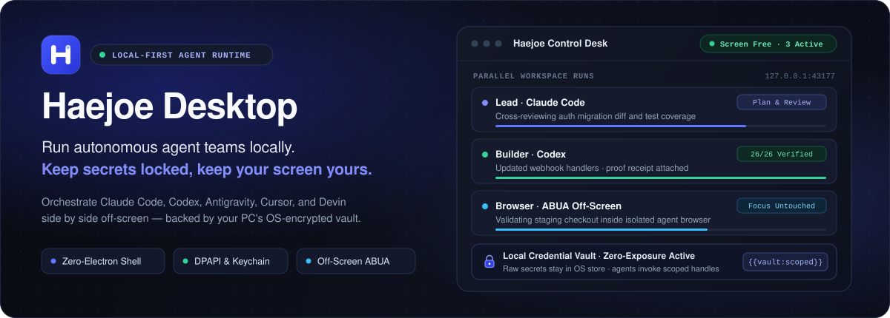
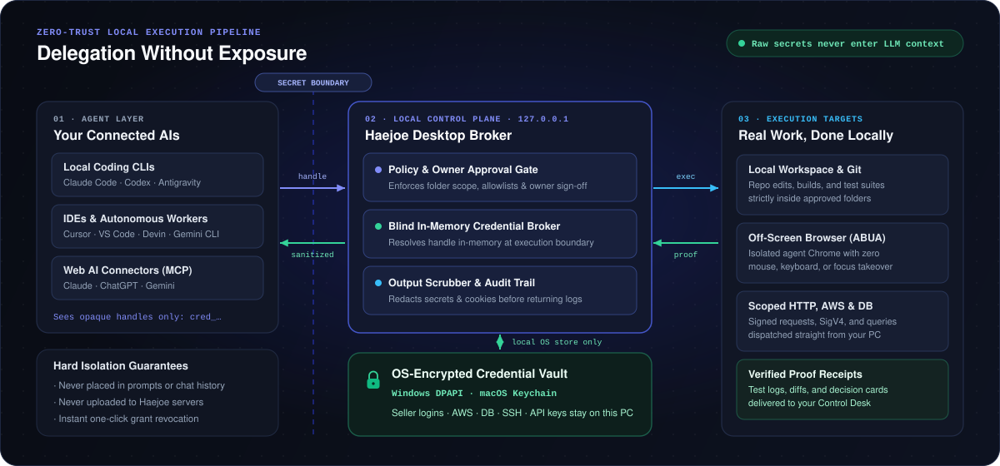
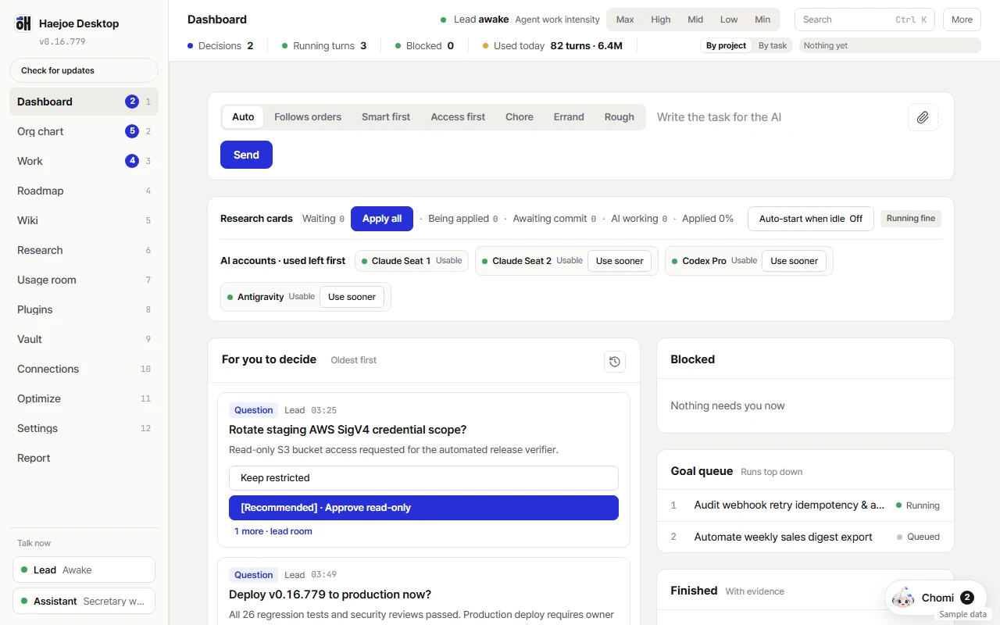
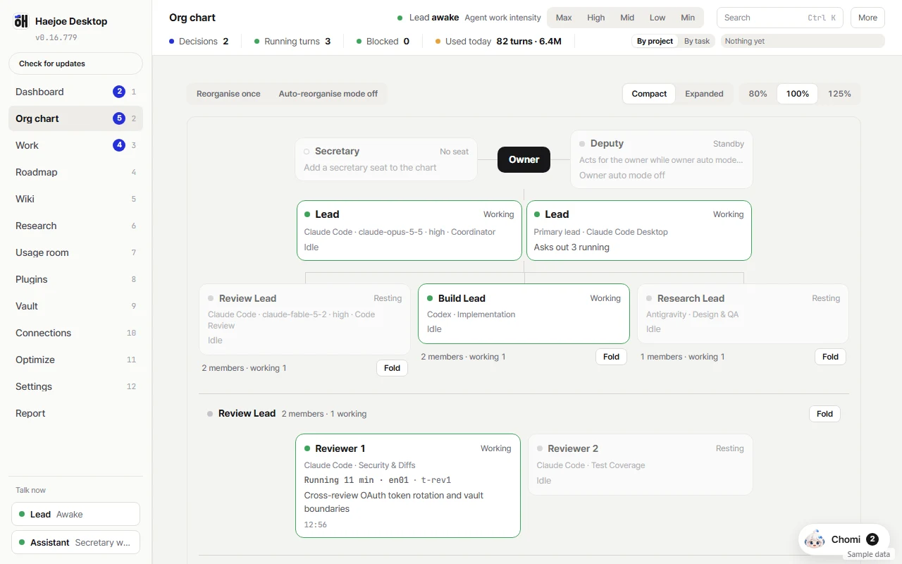
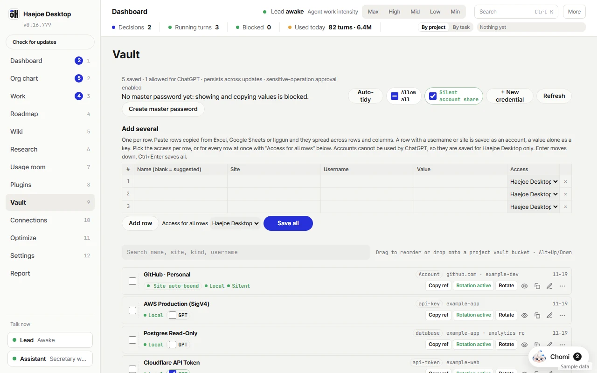

<div align="center">

<picture>
  <source media="(prefers-color-scheme: dark)" srcset="assets/hero-dark.svg" />
  <source media="(prefers-color-scheme: light)" srcset="assets/hero-light.svg" />
  
</picture>

<br />

<h3>Run autonomous agent teams locally. Keep secrets locked, keep your screen yours.</h3>

<p>
  <strong>English</strong> &nbsp;·&nbsp;
  <a href="docs/README.ko.md">한국어</a> &nbsp;·&nbsp;
  <a href="https://haejoe.com/local">Website</a> &nbsp;·&nbsp;
  <a href="https://haejoe.com/local/setup">Setup Guide</a> &nbsp;·&nbsp;
  <a href="SECURITY.md">Security</a> &nbsp;·&nbsp;
  <a href="CHANGELOG.md">Changelog</a>
</p>

<p>
  <a href="https://github.com/thekeunpie-hash/haejoe-desktop/releases/latest">
    
  </a>
  <a href="https://haejoe.com/local">
    
  </a>
  <a href="#quick-install">
    
  </a>
  <a href="SECURITY.md">
    
  </a>
  <a href="docs/README.ko.md">
    
  </a>
  <a href="https://chromewebstore.google.com/detail/haejoe-browser-remote/jgkchidplncmhdokaakfdljnlgmihhnn">
    
  </a>
</p>

<p>
  <sub>
    Haejoe Desktop is a closed-source commercial desktop product. This repository is the official public hub for releases, architecture documentation, integrity verification, and issue tracking.
  </sub>
</p>

</div>

---

## Quick Install

Install in one command. Both scripts fetch the current release manifest over HTTPS, verify exact byte length and SHA-256 checksum locally, and stop immediately if anything does not match.

### Windows (PowerShell)

```powershell
irm https://haejoe.com/install.ps1 | iex
```

### macOS / Linux (Terminal)

```bash
curl -fsSL https://haejoe.com/install.sh | sh
```

<details>
<summary><strong>Install via Claude Code, Codex, or Antigravity (Zero-Touch Setup)</strong></summary>

<br />

Already live inside an AI coding CLI? Paste this prompt into **Claude Code**, **Codex**, or **Antigravity** and let it install Haejoe Desktop and wire up your local MCP connectors, hooks, and workspace sync automatically:

**Windows**

```text
Install Haejoe Desktop on this PC and finish connecting it.
1) In a terminal, run: irm https://haejoe.com/install.ps1 | iex
2) Once installed, read https://haejoe.com/local/setup.txt and run only the listed setup commands (`haejoe-local setup plan --json`, `haejoe-local setup apply`, `haejoe-local setup report`).
Never type passwords or card numbers; if a sign-in is needed, open the sign-in window and pause for me.
```

**macOS / Linux**

```text
Install Haejoe Desktop on this PC and finish connecting it.
1) In a terminal, run: curl -fsSL https://haejoe.com/install.sh | sh
2) Once installed, read https://haejoe.com/local/setup.txt and run only the listed setup commands (`haejoe-local setup plan --json`, `haejoe-local setup apply`, `haejoe-local setup report`).
Never type passwords or card numbers; if a sign-in is needed, open the sign-in window and pause for me.
```

</details>

> **Browser companion & mobile desk:** Add [Haejoe Browser Remote](https://chromewebstore.google.com/detail/haejoe-browser-remote/jgkchidplncmhdokaakfdljnlgmihhnn) from the Chrome Web Store to bridge Chrome sessions, or open [haejoe.com/local](https://haejoe.com/local) on iOS / iPadOS for WebPush notifications and Passkey approvals.

---

## Why Haejoe Desktop

Most agent tools act like fragile remote controls: you babysit one terminal at a time, paste API keys into plaintext files, and stop working whenever a browser automation grabs your cursor. Haejoe Desktop takes the middle-management seat on your PC so your agent team keeps shipping while you stay in control.

| Capability | Manual Remote-Control & Single-Tab Tools | Haejoe Desktop |
| :--- | :--- | :--- |
| **Autonomous Delivery Loop** | Manual copy-paste between disconnected chat tabs and terminals; stalled runs wait silently until you notice. | **Plan → Build → Cross-Verify loop.** A lead agent splits parallel tasks across Claude Code, Codex, Antigravity, Cursor, and Devin, collects proof receipts, and queues only owner decisions in one non-blocking desk. |
| **Off-Screen Control (ABUA · ACUA)** | Screen-hijacking automation moves your mouse, steals window focus, and blocks your desktop while running. | **Ambient off-screen execution.** ABUA (Ambient Browser Use Automation) and ACUA run inside an isolated off-screen agent browser and background channels so your mouse, keyboard, and foreground apps stay yours. |
| **Secret Isolation** | Credentials live in `.env` files, shell history, or chat prompts where models and third-party logs can see them. | **OS-encrypted local vault (Windows DPAPI · macOS Keychain).** Agents pass opaque handles (`cred_…`); Haejoe Desktop binds secrets strictly in-memory at execution time and redacts outputs before returning. |
| **Lightweight Desktop Shell** | Heavy 200–400 MB+ Electron wrappers shipping duplicate Chromium binaries and extra CLI runtimes. | **Zero-Electron shell.** Built on a ~7.6 MB `txiki.js` + native WebView2 shell that reuses the official Chrome and Codex already installed on your PC. |
| **Multi-Account Quota Pooling** | Hit a 5-hour or weekly rate limit mid-task and lose session context across tools. | **Unified subscription pool.** Connect the AI plans you already pay for with live usage visibility, automatic failover across seats, and clean session recovery. |

---

## Architecture: Delegation Without Exposure

Credentials and execution authority stay separated by design. AI agents never read raw passwords, seller logins, AWS keys, database credentials, or browser cookies.

<div align="center">

<picture>
  <source media="(prefers-color-scheme: dark)" srcset="assets/architecture-dark.svg" />
  <source media="(prefers-color-scheme: light)" srcset="assets/architecture-light.svg" />
  
</picture>

</div>

### Two Modes, One Local Runtime

- **Developer Orchestrator Mode** — Tie together the AI subscriptions you already use (Claude Code, Codex, Antigravity, Cursor, VS Code, Devin, Gemini CLI, Claude, ChatGPT, Gemini) inside a single local workspace. Run parallel builders and independent reviewers with automatic limit handoff and proof-backed completions.
- **Client Vault Mode** — Pair with [haejoe.com](https://haejoe.com) to delegate real operational and engineering tasks without handing over raw passwords. Keep Coupang/Naver seller accounts, AWS IAM keys, SSH keys, and database credentials locked in your own PC Vault; approve scoped requests for contracted developers and revoke access in one click.

---

## Inside Haejoe Desktop

Real screenshots captured in native English mode with synthetic sample data from the shipped desktop app. Haejoe Desktop automatically matches your OS language (`English` / `한국어`) and lets you switch live at any time.

<table>
  <tr>
    <td width="50%" valign="top">
      
      <p align="center"><sub><strong>Control Desk</strong> — Parallel runs, non-blocking decision cards, goal queue, and live multi-account quota pool.</sub></p>
    </td>
    <td width="50%" valign="top">
      
      <p align="center"><sub><strong>Agent Org Chart</strong> — Visual hierarchy for lead coordinators, parallel builders, and independent reviewers across seats.</sub></p>
    </td>
  </tr>
  <tr>
    <td colspan="2" valign="top">
      
      <p align="center"><sub><strong>Personal Credential Vault</strong> — OS-encrypted storage (Windows DPAPI / macOS Keychain) with per-item scope controls and windowless account brokering.</sub></p>
    </td>
  </tr>
</table>

---

## Supported Agents & Platforms

| Layer | Supported Ecosystem |
| :--- | :--- |
| **Coding CLIs & IDEs** | Claude Code, OpenAI Codex, Antigravity (`agy`), Cursor, VS Code, Devin, Gemini CLI |
| **Web AI Connectors** | Claude, ChatGPT (Developer Mode), Gemini via authenticated MCP bridge |
| **UI Languages (i18n)** | Native English & Korean across desktop, system tray menu, native approval/vault dialogs, updater, and iOS/iPadOS remote deck |
| **Windows 10 / 11** | Native desktop app (`txiki.js` + WebView2), local bridge (`127.0.0.1:43177`), DPAPI Vault, ABUA off-screen Chrome |
| **macOS & Linux** | Native launcher / CLI bridge (`127.0.0.1:43177`), MCP connector, macOS Keychain integration, Chrome extension |
| **iOS / iPadOS** | Home Screen WebApp Control Desk with WebPush notifications and Passkey approvals |

---

## Verification & Trust

- **Automated integrity checks:** Both `install.ps1` and `install.sh` check exact byte length and SHA-256 against the official manifest before launching anything. Full manual verification steps are documented in [SECURITY.md](SECURITY.md).
- **Windows SmartScreen note:** Authenticode code-signing enrollment is in progress, so Windows SmartScreen may show an unrecognized-publisher prompt on first launch. Verify the SHA-256 digest against [haejoe.com/local](https://haejoe.com/local), then choose **More info → Run anyway**.
- **Privacy boundary:** Project files stay on your machine by default. Only content explicitly read by a connected AI provider is sent to that provider under your own account plan.

---

## Community & Support

- **Product & Releases:** [haejoe.com/local](https://haejoe.com/local)
- **Zero-Touch Setup Guide:** [haejoe.com/local/setup](https://haejoe.com/local/setup)
- **Report a Bug:** [Open a bug report](https://github.com/thekeunpie-hash/haejoe-desktop/issues/new?template=bug_report.yml)
- **Request a Feature:** [Open a feature request](https://github.com/thekeunpie-hash/haejoe-desktop/issues/new?template=feature_request.yml)
- **Security Disclosure:** [SECURITY.md](SECURITY.md) or `admin@haejoe.com`
- **Haejoe Escrow Platform:** [haejoe.com](https://haejoe.com)
